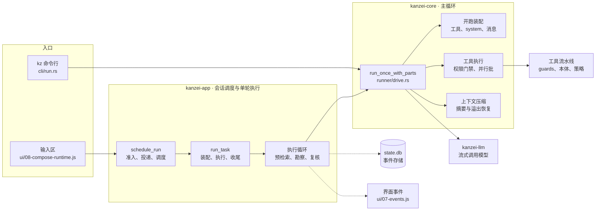
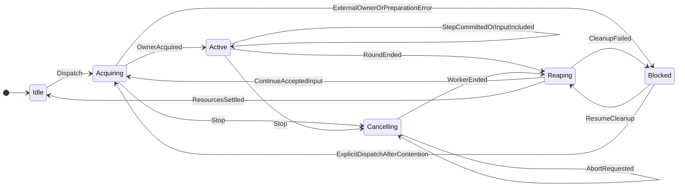
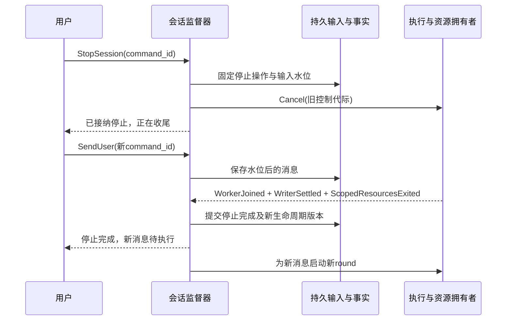

# 运行时主循环

输入区经过 kanzei-app 的 `schedule_run` 准入、投递和调度，`run_task` 负责一轮的装配、执行和持久收尾。执行循环依次做记忆预检索、勘察、主循环与复核；kanzei-core 的 `run_once_with_parts` 是主循环本体。桌面运行服务使用 core 会话监督器；CLI 复用同一个会话执行守卫和领域事实，执行锁覆盖两种入口。点节点打开对应实现。

本文维护会话状态机、所有权和验证合同。2026-10-26 的修复将桌面生命周期收敛到 core 的 `ConversationSupervisor`，宿主负责执行副作用和完成屏障。领域状态和实际资源回执共同决定后继状态；界面计时器不能生成执行终态。CLI 尚未提供常驻桌面 actor 的事件接口，但不能绕过跨进程执行锁。

## 当前实现与所有权

| 范围 | 实现与合同 |
| --- | --- |
| 前台生命周期 | `kanzei-core/src/session_lifecycle.rs` 的 `ConversationSupervisor` 校验合法转换；SessionRuntime 的 busy、压缩状态和 generation 从该快照派生，不再维护 running/compacting 双标志 |
| worker 与监督器 | `kanzei-app/src/commands/run.rs` 持有调度器与执行锁，单轮 worker 独立 spawn；`session_supervisor.rs::worker_result` 在协作取消期限后 abort 并 join worker，父任务继续回收和排队调度 |
| 写入完成 | SessionExecutionGuard 为每个 TypedSessionWriter 保留所有权与完成回执；父任务 join worker 后等待所有 writer 退出，最后释放执行锁再发布 Idle |
| 停止截止线 | SessionStore::request_session_stop 在事务中固定输入 sequence，只立即取消 pending；重复请求返回仍在进行的同一操作。worker 的 stopped terminal 与活动输入 cancelled 同事务提交；settle_session_stop 仅结清原截止线内的执行输入 |
| 后台回收 | Team、TaskCancellations 使用实际 owner 完成通知；停止回收子任务、终端退出与恢复、原生控制。失败进入 Blocked，保留错误和输入；显式重试停止后才能继续 |
| 空闲停止与关闭 | 空闲停止安装存活的 reaper；关闭先将 existence 置 Closing，再调用相同回收协议并 join，完成后才能注销和处置 worktree。服务退出复用该边界 |
| 输入回执 | 所有人工输入先入持久 inbox，包括第一条；outbox 为一次发送冻结 commandId，SQLite 同事务保存内容指纹和输入映射。重发复用原输入，改载荷冲突，相同正文的新命令仍独立准入 |
| 状态投影 | process_list.runtime 和 kz:lifecycle 共享 actor_epoch/revision；旧 actor 和旧版本不能覆盖新状态。停止确认期限只改为 unconfirmed 并查询，不伪造 stopped |
| 独立分区 | 输入使用持久 inbox，后台资源使用原注册表，自动推进使用 AutoRunController，客户端发送使用 outbox。它们不合并进一个运行布尔值；自动推进等待资源完成通过通知唤醒 |

`sessions.status` 和 round result 是持久历史投影，typed 轮末仍可先提交结果；它们不证明运行资源已经释放，也不参与桌面执行准入。活跃执行权由监督器与 SessionExecutionGuard 判定。停止请求不再调用立即写 idle 的 finalize_interrupt 路径。kz:turn 是步骤信号，kz:done 是单轮结果，二者都不能绕过监督器改变前台生命周期。

源码定位：[领域转换](../../crates/kanzei-core/src/session_lifecycle.rs)、[宿主回收](../../crates/kanzei-app/src/session_supervisor.rs)、[调度与输入 drain](../../crates/kanzei-app/src/commands/run.rs)、[客户端投影](../../crates/kanzei-app/ui/00-session-state.js)。

## 分区状态与唯一监督器

每个会话由一个 `ConversationSupervisor` 串行处理生命周期命令和完成事件。它持有前台执行所有权，管理所属执行任务和停止操作；worker、writer、终端和子任务报告结果，不直接改会话生命周期。监督器必须在其 worker 被强制取消后继续存活，完成资源回收并处理新输入。

状态、转换规则、持久命令回执与快照合同由 `kanzei-core` 的公开会话领域服务拥有。`kanzei-runtime` 组合异步执行宿主和能力；desktop、CLI、定时任务使用适配器接入。Tauri 句柄、窗口与 WebView 连接不进入 core；能力 crate 不反向依赖 runtime。复用现有 SessionStore、TypedSessionWriter、SessionExecutionGuard、AsyncMailbox 和资源注册表，不新建平行事实库。

监督器内的状态转换必须短且串行。数据库事务、文件锁和资源生命周期分别保持原有约束；等待模型、工具、JoinHandle、writer 线程或子进程退出时不持有 lifecycle mutex。副作用执行完后，以携带身份的事件回到监督器，再决定能否推进。

线性化点分别固定在命令准入事务、停止操作与水位的事务、typed 输入纳入事务以及最终生命周期提交。SQLite 提交与操作系统资源释放不共享一个原子事务；Reaping 必须覆盖这段间隙，在二者都成功后才发布完成。进程在间隙内崩溃时由下一实例在取得真实执行锁后恢复，不能通过先写 idle 消除中间态。

### 六个独立状态分区

| 分区 | 状态与事实 | 唯一写者 |
| --- | --- | --- |
| 会话存在性 | Open → Closing → Closed；关闭失败保留 Closing 与原因 | 会话监督器及其持久领域服务 |
| 前台生命周期 | Idle、Acquiring、Active、Cancelling、Reaping、Blocked | 会话监督器 |
| 输入投递 | admitted、claimed、incorporated，或未纳入前 cancelled；结局关联独立的运行事实 | core 输入服务与 typed writer，在领域事务内转换 |
| 后台资源 | 每个子任务、终端各自的运行/停止/退出状态，附所属会话和控制代际 | 资源拥有者；监督器维护作用域清单 |
| 自动推进 | 开关、暂停、待触发意图、停止原因 | 后端自动推进控制器；仅向监督器提交下一次运行意图 |
| 客户端观测 | 同步中、已连接、断开、状态未确认；本地发送 pending/accepted/unknown/rejected | 前端连接和 outbox 模型，不写后端执行状态 |

Active 内部记录实际工作种类和阶段，例如启动准备、等待项目租约、模型请求、工具批、等待前台权限/回答、提交结果、轮末收尾。压缩是需要同一会话独占权的工作种类，不再用额外的 compacting 布尔量与运行状态自行组合。后台提问仍是待答事项，不自动占住前台。

成功、失败、被用户停止、输出不完整是运行结局，保存在 `last_outcome`/历史事实里；它们不代替“当前还有没有执行者”的生命周期。前端 `running`、发送/停止按钮、阶段文字均由快照推导。等待自动推进期间，前台可以是 Idle。

### 前台状态图

图中的轮末 Reaping 是本轮写入、worker 和租约收尾；如果已有下轮输入，可在同一个监督器下继续使用会话执行守卫。只有转入 Idle 才必须释放本监督器的执行守卫。整次 Stop 的 Reaping 还必须等待其作用域内的后台资源退出。两种收尾范围必须由操作类型表达，不能用同一个 `done` 猜测。

Blocked 必须附具体原因：外部执行者占有、回收失败或无法恢复的领域错误。外部进程可以在任意时刻争用会话锁，快照不保证稍后锁一定可得；实际启动仍必须执行 `try_acquire`，如实返回争用，保留已接纳的输入。不得等待自己的 CLI 嵌套运行释放同一会话锁。

### 命令、守卫、转换与副作用

所有操作先核对会话存在性和身份；Open 下才接纳新的人工消息。下表中的“接纳”意味着输入和幂等回执已持久化。

| 当前状态 / 命令或事件 | 合法后继 | 必须完成的动作与限制 |
| --- | --- | --- |
| Idle / SendUser | Acquiring | 冻结原输入、附件、来源和执行意图，分配运行身份，申请唯一执行权 |
| Active / SendUser(steer) | Active | 输入先落盘，通知执行器；在完整工具结果提交后纳入，或替换尚未提交的模型草稿 |
| Active / SendUser(queue) | Active | 保持显式下一轮意图，不改当前运行的任务绑定、模型或来源 |
| Cancelling/Reaping/Blocked / SendUser | 原状态 | Open 时允许保存消息，标明待执行原因；在停止边界之后的新输入不得被旧 Stop 消费或取消 |
| Active / RoundEnded | Reaping | 运行结局和本轮事实持久化，停止并等待本轮 flush/worker；这不是会话级 idle |
| Reaping / ResourcesSettled，仍有合法输入 | Acquiring | 监督器继续下一轮；绑定该输入自己的执行意图，新建 round 身份和取消令牌 |
| Reaping / ResourcesSettled，无待执行输入 | Idle | 释放本监督器所有执行守卫和必须结清的资源，提交生命周期版本，再发布快照 |
| Idle/Acquiring/Active / StopSession | Cancelling 或 Reaping | 固定停止操作、水位和旧资源作用域；取消旧 worker/权限等待/回调能力，执行资源回收 |
| Cancelling/Reaping / 同一停止操作重复到达 | 原状态 | 返回原回执，不扩展取消水位，不取消后来接纳的新消息 |
| Cancelling / GraceExpired | Cancelling | 发出 AbortWorker 副作用；`abort()` 返回不产生静止事件 |
| Cancelling / WorkerJoined | Reaping | 再核对 writer、会话守卫、子任务和终端的退出依据 |
| Cancelling / 迟到 OwnerAcquired | Reaping | 回收迟到取得的所有权，禁止启动模型；不能只丢掉事件而泄漏资源 |
| 任意前台状态 / CloseConversation | 由 Open 进入 Closing | 停止接纳新消息，执行完整停止与回收；成功后才注销身份和处置工作树 |
| Closing / CloseResourcesSettled | Closed | 完成持久退役和资源处置；失败保留对象及错误，不伪造关闭成功 |
| 任意 / 旧运行的进度或终态 | 不改变当前生命周期 | 合法持久历史仍可回放；旧草稿、控制事件不能覆盖当前运行 |
| 任意 / 前端超时、连接断开 | 不改变后端生命周期 | 只改变观测状态并请求权威快照；不自动重发人工请求或生成 stopped |

非法转换必须返回带当前版本和原事件的诊断，不能自动转成 idle。副作用失败回到明确的失败事件；有资源未结清时进入 Blocked，保留可恢复的清理凭据。

## 输入、执行层级与异步语义

层级统一为：会话 → 一次调度所有权 → 多个 round → 多个 model step → response attempt/tool batch。现有 typed `turn_id` 是 round 的持久身份；`source_step` 可以在流水线阶段内从 1 开始，`logical_step` 由 writer 归一。重试或插话导致的 response attempt 不产生新的 round，也不重跑已提交工具。

| 对象 | 要证明的事实 | 不能推断的事实 |
| --- | --- | --- |
| CommandReceipt | 该 command_id 已被接纳或明确拒绝 | 模型已收到、工作已完成 |
| Input admitted | 原文、附件、来源和顺序已保存 | 已纳入当前请求 |
| Input incorporated | 已绑定到具体 round/step 的模型上下文；投递过程按事务提交 | 模型已理解、用户目标已完成 |
| Round outcome | 该轮实际结束方式及其关联输入 | 后台任务全部结束、会话已空闲 |
| Foreground idle | 本监督器没有前台执行者及其未释放所有权 | 所属后台子任务或终端全部结束 |
| Stop receipt settled | 该次 Stop 指定的资源作用域已静止 | 之后接纳的新任务也应被取消 |
| Service quiescent | 全局关闭准入、全部会话和资源已回收 | 可以省略各资源的退出证据 |

保留来源数据的授权边界。后台结果与 Agent 消息按原来源入账，不能转成新的用户授权。当前输入表的 completed 既用于轮末又用于插话投递；迁移时需按对应事实解释，不能批量把历史 completed 宣称为任务完成。

### 停止边界与新输入

StopSession 在监督器串行处理处固定 `stop_operation_id`、`control_epoch` 和 `input_cutoff`。水位使用已有 `prompt.admitted` 的会话 sequence，或者与其同事务分配的等价顺序键，不依赖毫秒时间或正文去重。

停止只覆盖水位内尚未纳入执行的输入，以及旧控制代际所属的资源；已经纳入执行的输入等待其运行真实停止结局。水位之后的人工消息正常保存，旧 worker 不得消费，重复 Stop 不扩大水位。用户要撤销新消息时使用 CancelInput。关闭会话则先禁止准入，不存在水位之后继续启动新任务的通道。

同一个 command_id 的重试返回同一持久回执；载荷不同则返回冲突。相同文本配不同 command_id 是两条合法人工输入。IPC 断线或超时先显示 unknown，通过原 ID 查回执或幂等重发；只有明确拒绝才显示 rejected。停止正在进行时再次提交 Stop 返回已有停止操作。

发送本身不停止任务。插话时，已提交的工具调用和结果成对保留；未提交的响应草稿可以废弃。长命令/子任务要让出前台时，必须完成原拥有者到后台注册表的交接，保留同一个进程/任务身份及回传目的地；不能为回答进度而取消、重跑原工作。后台回调可以纳入当前任务或唤醒空闲会话，但不能打断正在输出给用户的回答，也不能越过已撤销的控制代际。

## 事件身份、快照与重连

| 标识 | 作用域与约束 |
| --- | --- |
| project/session | 使用现有规范化主根与稳定会话身份；窗口选择不是执行身份 |
| actor_epoch | 每次后端监督器实例的不可复用身份；阻止重启前事件污染新实例 |
| state_revision | 同一 actor_epoch 内单调增长的生命周期版本；控制事件和运行快照共同携带 |
| owner_id / round_id | 区分持锁调度范围与单轮；round_id 复用现有持久 turn/run 身份，不平行生成第二套对应 ID |
| step / attempt | step 复用 writer 的逻辑步；attempt 标记可废弃的草稿响应，不能与重新执行工具混为一谈 |
| command_id / input_id | 分别关联幂等命令回执与持久输入；保留显式对应关系 |
| control_epoch / stop_operation_id | 分别约束后台回调能力与一次停止操作；不是模型授权 |
| source_sequence | 现有 SQLite 会话事件 sequence；用于持久事实回放与快照水位，不替代运行时 state_revision |

`run_generation`、`async_generation` 不能直接当成完整 IPC 协议。新协议中的角色确定后，将它们映射或替换；迁移期只在边界适配，不能长期双写两套控制状态。

重连按“订阅并缓冲 → 取得同一 actor 的权威快照及水位 → 应用水位之后的事件”进行，或使用等价的原子快照/订阅接口。快照必须覆盖生命周期、当前运行、输入投递、停止操作和后台资源摘要。无法读取保持 Unknown/Disconnected，并保留最后可信快照，不改为 idle。

后端重启分配新的 actor_epoch。持久 sessions.status 是上次写入的事实，不能单独证明仍有执行者；孤儿运行的恢复必须在成功取得对应 SessionExecutionGuard 后，复用其 owned recovery 与 typed facts 完成。外部 CLI 仍持锁时不能替它写入停止结局。仅打开一个未使用的会话不创建运行历史；恢复出的 pending 输入保留来源、顺序和原执行意图，不把恢复本身当成新增用户授权。

旧 revision 不能覆盖新投影；遇到 actor_epoch 变化先重新同步。运行控制事件核对当前 owner/round；草稿增量额外核对 step/attempt。旧 round 的持久事实仍进入对应历史，不因控制过滤而丢失。删除、压缩或按类型过滤后的历史不能假定所有 sequence 连续；回放缺口由查询返回的范围和完整性合同判断。

`kz:turn`、`kz:done`、`kz:stopped`、`process_list.running` 暂为兼容投影。目标协议分别表达 StepStarted、RoundFinished、StopRequested、StopSettled、LifecycleChanged；其中只有监督器的生命周期事件能改变前台执行状态。IPC 回执与事件次序互不充当隐含屏障。

## 不变量与验收矩阵

1. 同一规范化数据库/会话最多有一个前台执行所有者；worker、writer 的迟到存活仍属于该所有权。
2. Idle 表示本监督器已释放前台执行所有权；整次 Stop 完成还要证明其作用域资源静止。
3. StopRequested、令牌已取消、future 已 abort、轮末事实已写入，都不能单独证明 StopSettled。
4. 同一输入最多纳入一次；已接纳输入有明确归属和投递状态，不因断线、切窗口或强制中断静默丢失。
5. Stop 的输入水位和资源作用域固定；之后的新输入与新资源不受旧清理操作影响。
6. 已提交工具与结果不拆开，废弃草稿不执行其尚未提交的工具。
7. worker 被强制取消不销毁监督器；恢复后它仍会结清旧所有权并调度合法的新输入。
8. Closing/Closed 拒绝新准入；工作树处置在所需资源静止之后执行。
9. 前端超时、轮询和视图切换只更新观测，不创造后端运行终态。
10. 持久输入、历史事实、运行中资源与传输连接各有真源；副作用失败不能靠状态默认值消失。

以下为迁移必须补齐的验收范围，不将既有 happy-path 测试数量当作该矩阵已通过。使用可控屏障、虚拟时钟和确定性的本地服务制造交错，不依赖固定 sleep 碰撞竞态。

| 场景 | 必须验证的结果 |
| --- | --- |
| 准入后、worker 启动前 Stop | 不发起新工具/模型工作，迟到取得的锁有明确回收 |
| 请求头等待、流输出、退避期间插话 | 新消息可被纳入，旧草稿可撤销，已提交工作保留 |
| 并行工具批进行中插话 | 工具结果完整提交；可交接的长任务保持原 PID/任务 ID |
| 常规轮末、flush 正在持有 writer | 不提前 idle，不启动第二个所有者 |
| 第一次 Stop → 新输入 → 第二次 Stop | 新输入保留，只执行一次；取消水位不扩大 |
| GraceExpired → abort → 延迟析构/写入线程 | 保持 Cancelling/Reaping，直到真实回收完成 |
| 硬中断后已有新输入等待 | 存活的监督器继续调度，不留下无消费者队列 |
| 主轮结束但子任务/终端仍运行 | 前台可 Idle，后台状态继续真实显示；追问可执行 |
| 空闲主轮上 Stop 后台任务 | 等待原作用域资源退出后才确认整次停止完成 |
| 旧终端回收与新消息启动交错 | 旧清理不能杀死新控制代际的终端或任务 |
| 运行中关闭/注销/清理 worktree | 先回收，再处置工作树和身份；失败时对象可见 |
| Stop 后旧 callback 到达，或重启后重放 | 历史可审计，旧控制能力不能唤醒新任务 |
| IPC 接纳成功但回执丢失 | 同 command_id 查询/重发无重复输入；相同正文的新 ID 不被合并 |
| 快照、终态事件、下一轮事件乱序 | 投影按 epoch/revision 收敛，旧轮终态不覆盖新运行 |
| 停止超过前端计时阈值、事件桥断开 | 显示状态未确认；连接恢复后按后端事实收敛 |
| 数据库终态写入或资源退出失败 | 保留错误和未结清状态，不能报告成功停止 |
| CLI/桌面争用同一会话，含路径别名 | 只有一个执行者；外部争用如实回报，不自锁等待 |
| 全局退出时有在途准入和新注册资源 | 准入先关闭，所有拥有者结清后才返回 quiescent |

## 实现与验收边界

领域测试覆盖非法转换、重复停止固定水位、回收失败阻止启动、关闭后拒绝命令、writer 实际完成屏障、命令回执回滚与重发。应用测试覆盖强制取消后的 join、停止后输入保留、真实历史提交和关闭前资源交接。浏览器测试使用生产 ESM 和可控时钟，覆盖旧版本/旧 actor、停止超时查询、outbox 重试与输入交付。

原生验收使用 WebView2、Rust 调度器、SQLite、Git、真实子任务与终端；模型响应来自隔离本地服务。这证明调度和 UI 链路，不等于真实模型质量验收。全表仍按各场景对应证据判断，不能用总用例数宣称所有系统故障交错均已覆盖。当前剩余适配范围是 CLI/定时任务的统一常驻 actor 事件接口，以及全部渲染增量的 step/attempt 版本协议；这些不参与桌面生命周期的权威判定。

旧运行布尔标志、后端停止 watchdog、请求停止时立即终态化、关闭后分离杀进程、前端超时造 stopped 已删除。旧事件保留历史/渲染兼容作用，不能重写已绑定权威快照的执行状态；生命周期通知携带相同版本，迟到的 idle 不能清除新一轮的答案。
